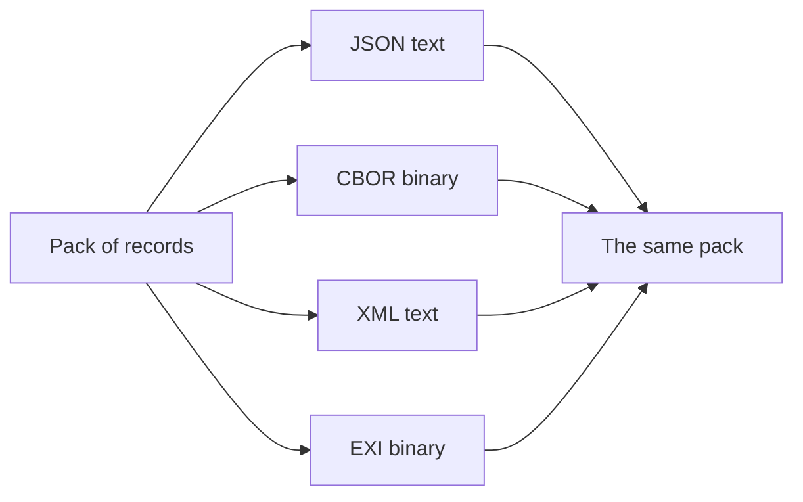

# Welcome

This guide shows you how to read and write sensor readings in Rust with rsenml,
one short example at a time.

rsenml implements **SenML** (Sensor Measurement Lists,
[RFC 8428](https://www.rfc-editor.org/rfc/rfc8428)). SenML is a small, standard
way for a device to report what it measured: a list of
[records](glossary.md#record), each with a name, a value, and maybe a unit and a
time. A thermostat, a water meter and a phone app can all agree on it without
sharing any code.

The same list can be sent in four formats. rsenml reads and writes all of them
from one data model:

New to SenML? [Words you'll see](glossary.md) explains each term in a line or two.

## What you will learn

Each chapter follows one small program in `examples/basics`, from easiest to
hardest:

1. **Your first pack**: build a pack, write it as JSON and read it back.
2. **Choosing a format**: the eight media types, their sizes and CoAP numbers.
3. **Base fields and resolving**: how records share names and times, and how to
   get full names and absolute times out.
4. **Checking packs**: what the RFC's rules refuse, and the stricter options.
5. **Streaming with SenSML**: writing and reading one record at a time.
6. **Small devices**: writing into a fixed buffer, with no `std`.
7. **When things go wrong**: the errors you can get back.

After that, [Untrusted input](untrusted-input.md) covers reading data from the
network, and [Where the RFC is unclear](rfc-choices.md) lists the choices rsenml
made where RFC 8428 leaves room.
